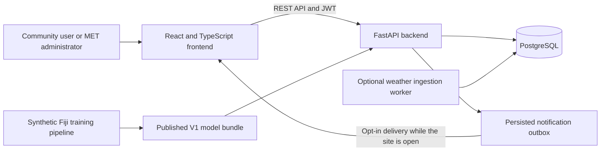

# FloodWatch Fiji

[Setup](#local-development) · [Architecture](#architecture-and-stack) · [Documentation](#documentation) · [Backend](backend/README.md) · [Frontend](frontend/README.md)

**Fiji Flood Risk Prediction and Community Alert System · IS314**

FloodWatch Fiji brings weather monitoring, flood risk analysis, mapping and
administrator-reviewed community alerts into one platform. A React frontend
connects to a FastAPI backend with PostgreSQL persistence, role-based access,
saved locations and browser notifications.

The current serving model is **Synthetic Fiji CatBoost V1**, which estimates
new flood onset over the next 24 hours using generated weather. Its results
describe simulator behaviour, not validated forecasting skill on real Fiji
events. Data sources and test records are labelled throughout the application.
Community alerts issued through this system are separate from official Fiji
Meteorological Service warnings, which always take precedence.

## Features

| Area | Implemented capabilities |
| --- | --- |
| Flood risk dashboard | Registry-based location and risk summaries, recent predictions, alert activity, prediction analytics and model performance views. |
| Weather monitoring | Persisted observations with source, timestamp, units, missing values and freshness status; administrator submissions and an optional ingestion worker. |
| Flood risk predictions | V1 synthetic historical analysis and inference from compatible stored synthetic weather, with model and input provenance. |
| Flood mapping | Interactive Leaflet map, location search, division and risk filters, weather details, prediction status and approved community alerts. |
| Alerts and notifications | Draft creation, review, approval, acknowledgement, resolution, cancellation, suppression, expiry, cooldown protection and retained history. Saved locations and opt-in browser delivery are supported. |
| Access management | Registration, administrator approval, JWT authentication and separate community/MET-administrator permissions enforced by the backend. |

The seeded development registry contains **12 locations across Fiji's four
divisions**. Dashboard and map records come from backend APIs; alert actions
are persisted rather than held only in browser state.

## Architecture and stack



- **Frontend:** React 19, TypeScript, Vite, Tailwind CSS, React Router, Leaflet and Recharts.
- **Backend:** Python 3.14, FastAPI, Pydantic, SQLAlchemy, Alembic and psycopg 3.
- **Authentication:** JWT access tokens, Argon2 password hashing and server-side account/role checks.
- **Model pipeline:** CatBoost, scikit-learn, pandas, NumPy and Parquet artifacts.
- **Tests:** pytest, Vitest and React Testing Library, with optional PostgreSQL integration tests.

## Data sources and model status

| Data or workflow | Current status |
| --- | --- |
| Actual weather observations | The weather API supports attributed manual/provider observations. An authoritative live station feed must be configured separately. The map currently requests the synthetic weather dataset. |
| Generated historical weather | Synthetic records support historical analysis and model evaluation. They are not Fiji MET station readings. |
| Model predictions | V1 produces provisional estimates for compatible synthetic inputs. Genuine-observation inference is blocked because validated geography, gauge compatibility and an operational Fiji model are unavailable. |
| Sample predictions | Seed records carry `is_sample=true`; they are not trained-model outputs. |
| Community alerts | Stored review records. Only approved, unexpired alerts for active locations appear in the operational public feed. |
| Historical-analysis test alerts | Separate synthetic tables and feeds. LOW/MODERATE tests require explicit test metadata; these records cannot publish operational warnings or enqueue operational notifications. |
| V2/V3 experiments | Research only. They do not replace deployed V1. The `/research` scenario view is read-only. |

Synthetic Fiji, Bangladesh research and the deprecated India experiment use
different datasets, schemas and artifacts. Their results are not interchangeable.
See the [synthetic methodology](docs/SYNTHETIC_METHODOLOGY.md) and
[V1 prediction contract](docs/V1_PREDICTION_WORKFLOW.md) for their boundaries.

## Repository layout

```text
frontend/               React application, component tests and frontend tooling
backend/
  app/                  API routes, services, schemas, models and database utilities
  migrations/           Ordered Alembic migrations
  tests/                API and service tests with isolated SQLite fixtures
  weather_tests/        PostgreSQL integration tests in disposable schemas
  ai/                   Deprecated India-dataset experiment
ml/
  synthetic/            Fiji simulator, training, evaluation and scenario studies
  foundation/           Bounded foundation-model benchmark configuration
  tests/                ML pipeline tests
docs/                   Architecture, workflows, methodology and research results
```

Each part has its own dependencies and commands. The top-level `ml` pipeline
also retains a separate Bangladesh historical benchmark. Generated datasets,
research runs and synthetic serving bundles are not included in Git.

## Local development

### Prerequisites

- Python **3.14**; the backend declares `requires-python >=3.14`.
- Node.js **20.19 or newer on the 20.x line, or 22.12+**, with npm.
- PostgreSQL and a database user with permission to create tables and types.
- Internet access for dependencies and OpenStreetMap basemap tiles.

Commands assume a POSIX shell and start from the repository root unless a block
changes directory. PostgreSQL is required for the application; SQLite is used
only by isolated backend tests.

### 1. Install dependencies

```bash
python3.14 -m venv backend/.venv
backend/.venv/bin/python -m pip install -r backend/requirements.txt -r ml/requirements.txt

cd frontend
npm ci
cd ..
```

The ML requirements provide the CatBoost and Parquet dependencies needed for
synthetic workflows. Foundation-model benchmarks use separate environments.

### 2. Configure the environment

Create a PostgreSQL user and empty development database using a PostgreSQL
administrator account, for example:

```sql
CREATE USER flood_app WITH PASSWORD 'choose-a-local-password';
CREATE DATABASE fiji_flood_risk OWNER flood_app;
```

Copy the examples only when local configuration does not already exist:

```bash
test -f backend/.env || cp backend/.env.example backend/.env
test -f frontend/.env || cp frontend/.env.example frontend/.env
```

In `backend/.env`, set `DATABASE_URL` to your PostgreSQL connection and replace
`JWT_SECRET_KEY` with a unique secret. Generate a value with:

```bash
backend/.venv/bin/python -c "import secrets; print(secrets.token_urlsafe(48))"
```

For local development, use `VITE_API_URL=http://127.0.0.1:8000` in `frontend/.env`.
Environment files are ignored by Git. Browser-visible `VITE_` variables must
never contain database credentials or JWT signing secrets.

### 3. Initialize a fresh development database

The Alembic history assumes that core application tables already exist. For an
**empty database only**, create the current schema, record its migration version
and seed the registry:

```bash
cd backend
.venv/bin/python - <<'PY'
from alembic import command
from alembic.config import Config
from sqlalchemy import inspect
from app import models
from app.db.base import Base
from app.db.session import get_engine, get_session_factory
from app.db.seed_locations import seed_demo_locations

engine = get_engine()
with engine.begin() as connection:
    if inspect(connection).get_table_names():
        raise SystemExit("Database is not empty. Apply migrations instead.")
    Base.metadata.create_all(connection)
command.stamp(Config("alembic.ini"), "head")
with get_session_factory()() as db:
    seed_demo_locations(db)
PY
```

The seed includes labelled sample risks. It does not import weather, train a
model or issue alerts. Re-running it resets seed locations and sample predictions,
so use it deliberately on an existing database.

For an **existing initialized database**, apply migrations from `backend/`:

```bash
.venv/bin/python -m alembic upgrade head
```

Do not stamp an existing database to skip migrations. The legacy `app.db.init_db`
utility uses `create_all`; it cannot replace migrations for an existing schema.
Starting uvicorn does not initialize or migrate tables.

### 4. Start the application

From `backend/`:

```bash
.venv/bin/python -m uvicorn app.main:app --reload --host 127.0.0.1 --port 8000
```

In a second terminal, from the repository root:

```bash
cd frontend
npm run dev -- --host 127.0.0.1 --port 5173 --strictPort
```

- Application: <http://127.0.0.1:5173>
- API health: <http://127.0.0.1:8000/api/health>
- Interactive API documentation: <http://127.0.0.1:8000/docs>

The backend permits frontend origins on `localhost:5173` and `127.0.0.1:5173`.
Use the fixed port above to match that CORS configuration.

### 5. Set up the first administrator

Register an account requesting `MET_ADMIN` through `/register`. New accounts
start as `PENDING` and cannot sign in until approved. The first administrator
must be approved through the documented
[database bootstrap procedure](backend/README.md#bootstrap-the-first-met-admin-for-development);
there is intentionally no public bootstrap API. That administrator can then
review later account requests in the application.

## Historical analysis and synthetic model setup

Authentication, registry views and alert management can run without a synthetic
model bundle. Historical analysis and V1 inference require locally prepared data
and published artifacts.

The approved V1 reproduction sequence runs from the repository root:

```bash
backend/.venv/bin/python -m ml.synthetic.generate --out ml/data/synthetic_fiji/v1 --seed 314
backend/.venv/bin/python -m ml.synthetic.train --dataset ml/data/synthetic_fiji/v1 --out ml/runs/synthetic-v1
backend/.venv/bin/python -m ml.synthetic.report --out ml/runs/synthetic-v1 --publish ml/artifacts/synthetic/v1
```

These outputs refuse overwrite. Run the sequence only when the output paths are
absent; preserve existing published V1 artifacts and use separate directories for
additional research runs. The [methodology guide](docs/SYNTHETIC_METHODOLOGY.md#9-reproduction-commands)
documents evaluation, stress testing and limitations.

Once the dataset and bundle are available, import historical replay records
from `backend/`:

```bash
.venv/bin/python -m alembic upgrade head
.venv/bin/python -m app.db.import_synthetic --dataset ../ml/data/synthetic_fiji/v1
```

The importer checks dataset integrity and registry identity. Historical replay
storage is separate from the weather API's tables; map weather details can remain
empty until observations are ingested. See [weather data management](docs/WEATHER_DATA_MANAGEMENT.md)
and the [stored-weather V1 workflow](docs/V1_PREDICTION_WORKFLOW.md) for ingestion
and bounded weather imports.

### Optional workflows

Configure these in `backend/.env` and restart the relevant process:

| Setting | Default | Purpose |
| --- | --- | --- |
| `SYNTHETIC_DEMO_ENABLED` | `false` | Permit administrator creation/approval of isolated historical-analysis alerts, including explicit low-risk tests. |
| `ALERT_DEMO_ENABLED` | `false` | Permit older, explicitly marked alert-workflow fixtures. These remain identified as simulated records. |
| `BROWSER_DELIVERY_ENABLED` | `false` | Permit browser delivery for subscribed accounts with notification consent. The site must remain open. |
| `WEATHER_INGESTION_ENABLED` | `false` | Enable the separately run ingestion worker after a feed has been configured. |
| `WEATHER_FEED_SYNTHETIC` | `true` | Identify feed records as synthetic; genuine attribution is reserved for actual observations. |
| `ALERT_TTL_HOURS` | `24` | Set the lifetime of newly approved operational alerts. |
| `ALERT_COOLDOWN_HOURS` | `6` | Coalesce repeated automatic recommendations, with the existing severity-escalation exception. |

To test alerts, sign in as an approved MET administrator, open **Historical
analysis**, load an eligible hour and create a simulated or explicitly marked
test alert. Operational alerts are managed under **Manage alerts**; historical
analysis alerts have a separate management area. Both support acknowledgement,
resolution, confirmed cancellation and retained history. See
[Alert management](docs/ALERT_MANAGEMENT.md) for the full lifecycle and API rules.

## Application routes

| Route | Access | Purpose |
| --- | --- | --- |
| `/weather-map` | Public | Weather monitoring and flood mapping |
| `/alerts` | Public | Approved community alerts |
| `/simulation` | Public read; MET-admin actions | Historical analysis and isolated test-alert management |
| `/research` | Public read-only | Synthetic V3 scenario analysis |
| `/dashboard` | Approved account | Community overview, saved locations and notification history |
| `/admin/dashboard` | MET administrator | Monitoring dashboard |
| `/admin/alerts` | MET administrator | Alert creation, review, active alerts and history |
| `/admin/analytics` | MET administrator | Stored prediction analytics |
| `/admin/model-performance` | MET administrator | Saved model metadata and evaluation results |
| `/admin/users/pending` | MET administrator | Pending-account review |

## Verification

Backend API and service tests use in-memory SQLite overrides. From `backend/`:

```bash
.venv/bin/python -m pytest tests -q
```

To exercise real PostgreSQL migrations, concurrency and persistence:

```bash
WEATHER_POSTGRES_TEST=1 .venv/bin/python -m pytest weather_tests -q
```

These integration tests use disposable schemas in the configured PostgreSQL
database; the database user needs permission to create schemas. Some other tests
require optional artifacts or their documented environment settings.

Frontend checks run from `frontend/`:

```bash
npm run lint
npm run test
npm run build
```

The production build includes TypeScript checks. ML tests run from the repository
root using an environment with `ml/requirements.txt` installed:

```bash
backend/.venv/bin/python -m pytest ml/tests -q
```

## Documentation

| Topic | Guides |
| --- | --- |
| Accounts and authentication | [Authentication workflow](docs/AUTHENTICATION_WORKFLOW.md), [backend reference](backend/README.md) |
| Alert management | [Current lifecycle, audit and migration guide](docs/ALERT_MANAGEMENT.md), [original alert architecture](docs/ALERT_SYSTEM.md) |
| Weather and inference | [Weather data management](docs/WEATHER_DATA_MANAGEMENT.md), [V1 prediction workflow](docs/V1_PREDICTION_WORKFLOW.md) |
| Synthetic Fiji model | [Methodology and evaluation](docs/SYNTHETIC_METHODOLOGY.md) |
| V2/V3 research | [V2 protocol](docs/SYNTHETIC_V2_PROTOCOL.md), [V2 results](docs/SYNTHETIC_V2_RESULTS.md), [V3 protocol](docs/SYNTHETIC_V3_PROTOCOL.md), [V3 results](docs/SYNTHETIC_V3_RESULTS.md) |
| Bangladesh historical benchmark | [Research contract](docs/RESEARCH_BANGLADESH.md), [measured technical report](ml/artifacts/technical_report.md) |
| Frontend architecture and history | [Historical UI integration guide](docs/PROTOTYPE_UI.md), [frontend reference](frontend/README.md) |

Some module guides retain earlier milestone descriptions. The setup above and
the current alert-management guide describe the present application workflow.
