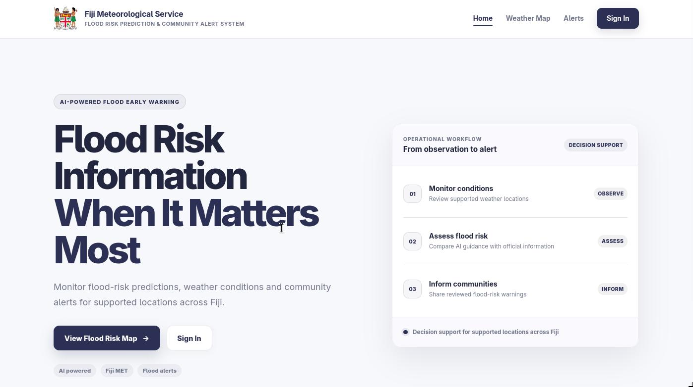
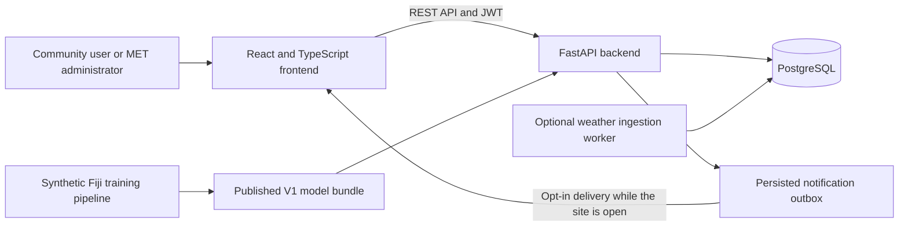

# FloodWatch Fiji

[Setup](docs/SETUP.md) · [Architecture](#architecture-and-stack) · [Documentation](#documentation) · [Backend](backend/README.md) · [Frontend](frontend/README.md)

**Fiji Flood Risk Prediction and Community Alert System · IS314**

FloodWatch Fiji brings weather monitoring, flood risk analysis, mapping and
administrator-reviewed community alerts into one platform. A React frontend
connects to a FastAPI backend with PostgreSQL persistence, role-based access,
saved locations and browser notifications.

The current serving model is **Synthetic Fiji CatBoost V1**, which estimates
new flood onset over the next 24 hours using generated weather. Its results
describe simulator behaviour, not validated forecasting skill on real Fiji
events. Data sources and test records are labelled throughout the application.
Community alerts issued through this system are separate from official Fiji
Meteorological Service warnings, which always take precedence.

## Features



| Area | Implemented capabilities |
| --- | --- |
| Flood risk dashboard | Registry-based location and risk summaries, recent predictions, alert activity, prediction analytics and model performance views. |
| Weather monitoring | Persisted observations with source, timestamp, units, missing values and freshness status; administrator submissions and an optional ingestion worker. |
| Flood risk predictions | V1 synthetic historical analysis and inference from compatible stored synthetic weather, with model and input provenance. |
| Flood mapping | Interactive Leaflet map, location search, division and risk filters, weather details, prediction status and approved community alerts. |
| Alerts and notifications | Draft creation, review, approval, acknowledgement, resolution, cancellation, suppression, expiry, cooldown protection and retained history. Saved locations and opt-in browser delivery are supported. |
| Access management | Registration, administrator approval, JWT authentication and separate community/MET-administrator permissions enforced by the backend. |

The seeded development registry contains **12 locations across Fiji's four
divisions**. Dashboard and map records come from backend APIs; alert actions
are persisted rather than held only in browser state.

## Architecture and stack



- **Frontend:** React 19, TypeScript, Vite, Tailwind CSS, React Router, Leaflet and Recharts.
- **Backend:** Python 3.14, FastAPI, Pydantic, SQLAlchemy, Alembic and psycopg 3.
- **Authentication:** JWT access tokens, Argon2 password hashing and server-side account/role checks.
- **Model pipeline:** CatBoost, scikit-learn, pandas, NumPy and Parquet artifacts.
- **Tests:** pytest, Vitest and React Testing Library, with optional PostgreSQL integration tests.

## Data sources and model status

| Data or workflow | Current status |
| --- | --- |
| Actual weather observations | The weather API supports attributed manual/provider observations. An authoritative live station feed must be configured separately. The map currently requests the synthetic weather dataset. |
| Generated historical weather | Synthetic records support historical analysis and model evaluation. They are not Fiji MET station readings. |
| Model predictions | V1 produces provisional estimates for compatible synthetic inputs. Genuine-observation inference is blocked because validated geography, gauge compatibility and an operational Fiji model are unavailable. |
| Sample predictions | Seed records carry `is_sample=true`; they are not trained-model outputs. |
| Community alerts | Stored review records. Only approved, unexpired alerts for active locations appear in the operational public feed. |
| Historical-analysis test alerts | Separate synthetic tables and feeds. LOW/MODERATE tests require explicit test metadata; these records cannot publish operational warnings or enqueue operational notifications. |
| V2/V3 experiments | Research only. They do not replace deployed V1. The `/research` scenario view is read-only. |

Synthetic Fiji, Bangladesh research and the deprecated India experiment use
different datasets, schemas and artifacts. Their results are not interchangeable.
See the [synthetic methodology](docs/SYNTHETIC_METHODOLOGY.md) and
[V1 prediction contract](docs/V1_PREDICTION_WORKFLOW.md) for their boundaries.

## Repository layout

```text
frontend/               React application, component tests and frontend tooling
backend/
  app/                  API routes, services, schemas, models and database utilities
  migrations/           Ordered Alembic migrations
  tests/                API and service tests with isolated SQLite fixtures
  weather_tests/        PostgreSQL integration tests in disposable schemas
  ai/                   Deprecated India-dataset experiment
ml/
  synthetic/            Fiji simulator, training, evaluation and scenario studies
  foundation/           Bounded foundation-model benchmark configuration
  tests/                ML pipeline tests
docs/                   Architecture, workflows, methodology and research results
```

Each part has its own dependencies and commands. The top-level `ml` pipeline
also retains a separate Bangladesh historical benchmark. Generated datasets,
research runs and synthetic serving bundles are not included in Git.

## Project setup

See the [project setup guide](docs/SETUP.md) for prerequisites, installation,
database initialization, running the app, synthetic model setup and verification.

## Application routes

| Route | Access | Purpose |
| --- | --- | --- |
| `/weather-map` | Public | Weather monitoring and flood mapping |
| `/alerts` | Public | Approved community alerts |
| `/simulation` | Public read; MET-admin actions | Historical analysis and isolated test-alert management |
| `/research` | Public read-only | Synthetic V3 scenario analysis |
| `/dashboard` | Approved account | Community overview, saved locations and notification history |
| `/admin/dashboard` | MET administrator | Monitoring dashboard |
| `/admin/alerts` | MET administrator | Alert creation, review, active alerts and history |
| `/admin/analytics` | MET administrator | Stored prediction analytics |
| `/admin/model-performance` | MET administrator | Saved model metadata and evaluation results |
| `/admin/users/pending` | MET administrator | Pending-account review |

## Documentation

| Topic | Guides |
| --- | --- |
| Accounts and authentication | [Authentication workflow](docs/AUTHENTICATION_WORKFLOW.md), [backend reference](backend/README.md) |
| Alert management | [Current lifecycle, audit and migration guide](docs/ALERT_MANAGEMENT.md), [original alert architecture](docs/ALERT_SYSTEM.md) |
| Weather and inference | [Weather data management](docs/WEATHER_DATA_MANAGEMENT.md), [V1 prediction workflow](docs/V1_PREDICTION_WORKFLOW.md) |
| Synthetic Fiji model | [Methodology and evaluation](docs/SYNTHETIC_METHODOLOGY.md) |
| V2/V3 research | [V2 protocol](docs/SYNTHETIC_V2_PROTOCOL.md), [V2 results](docs/SYNTHETIC_V2_RESULTS.md), [V3 protocol](docs/SYNTHETIC_V3_PROTOCOL.md), [V3 results](docs/SYNTHETIC_V3_RESULTS.md) |
| Bangladesh historical benchmark | [Research contract](docs/RESEARCH_BANGLADESH.md), [measured technical report](ml/artifacts/technical_report.md) |
| Frontend architecture and history | [Historical UI integration guide](docs/PROTOTYPE_UI.md), [frontend reference](frontend/README.md) |

Some module guides retain earlier milestone descriptions. The [setup guide](docs/SETUP.md)
and current alert-management guide describe the present application workflow.
