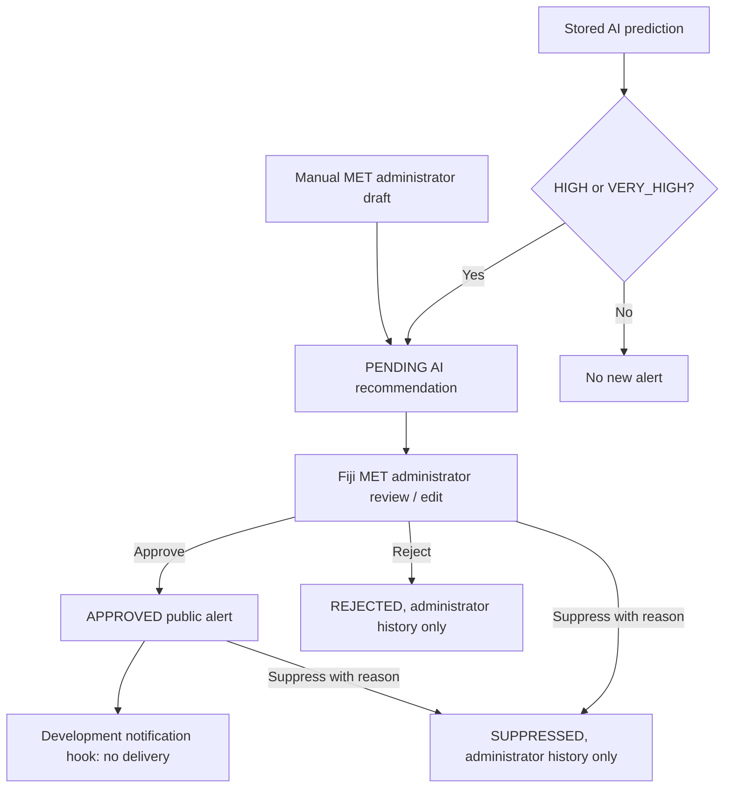

# Alert System backend

This milestone persists flood alerts and provides administrator review and public
read APIs. It reuses the existing SQLAlchemy session, JWT authentication, account
approval checks, and `MET_ADMIN` role. It does not run the ML model, fetch weather,
deliver notifications, or connect the frontend's local demo alert data.

## Existing architecture and schema additions

Before this milestone the backend had only the `User` model, authentication and
account-review APIs, a placeholder risk endpoint, and a standalone AI package.
There were no Location, Prediction, Alert, notification, or audit-log services.
Schema setup uses `python -m app.db.init_db` and SQLAlchemy `create_all`.
Alembic is installed but no migration configuration exists.

The alert milestone adds three tables without altering existing users:

| Table | Purpose and fields |
| --- | --- |
| `locations` | Minimal monitored-location reference: integer `id`, `name`, `is_active`. No location-management or mapping API is added. |
| `predictions` | Stored inference reference: integer `id`, `location_id`, controlled `risk_level`, `flood_probability`, `model_version`, timezone-aware `predicted_at`. No predictions are generated or seeded. |
| `alerts` | Integer `id`, `location_id`, optional `prediction_id`, severity, status, source, message, creation timestamp and administrator audit fields. |

Prediction `confidence_percent` is derived as `flood_probability * 100`, matching
the standalone AI contract. It is not a calibrated confidence in correctness.
UTC timestamps follow the existing authentication timestamp strategy; responses
normalize them to UTC, including SQLite fixtures that omit timezone information.

Native PostgreSQL enums are `risk_level`, `alert_status`, and `alert_source`.
The shared risk enum contains `LOW`, `MODERATE`, `HIGH`, and `VERY_HIGH`.
Separate alert/account status enums prevent the account workflow from being
confused with alert review.

Foreign keys restrict deletion of referenced locations, predictions, and audit
users. A composite foreign key ensures an alert's prediction belongs to the same
location. Check constraints enforce nonblank messages, required AI references,
manual creators, review audit fields, suppression reasons, and valid probability
ranges. A unique `(location_id, prediction_id)` pair prevents duplicates across
all states and sources. PostgreSQL permits multiple `NULL` prediction IDs, so
independent manual alerts without predictions remain possible.

Audit fields record manual creator, last editor, approver, rejector, suppressor,
their relevant timestamps, and suppression reason. Approval audit survives a
later suppression. This is a simple audit record, not a complete edit-history log.

## Lifecycle and publication boundary



**An AI-generated recommendation is not an official Fiji MET warning until an
authorized administrator approves it.** Neither automatic generation nor manual
draft creation publishes an alert. The default AI message identifies itself as
an AI recommendation for review. Administrators should edit the message into
suitable public wording and verify local conditions before approval.

| Starting state | Allowed actions |
| --- | --- |
| `PENDING` | Edit message/severity; approve; reject; suppress with reason |
| `APPROVED` | Suppress with reason |
| `REJECTED` | Read historical record |
| `SUPPRESSED` | Read historical record |

There is no reapproval, revival, or deletion workflow. A new prediction may
create a new recommendation; retrying an old prediction reuses its historical
alert without changing its state. Approved alerts cannot be edited in place;
withdraw them through suppression if necessary.

The public active endpoint returns only `APPROVED` alerts for active locations.
Pending, rejected, suppressed, and inactive-location records never appear there.
There is no automatic expiry in this milestone; administrators suppress an alert
to withdraw it. Internal administrator IDs and suppression reasons are excluded
using a separate public response schema.

## Endpoints

Every `/api/admin/alerts` action requires an HS256 JWT for an active, approved
`MET_ADMIN`, using the existing `require_met_admin` dependency. A community user
receives 403; missing/invalid/expired credentials receive 401. No authentication
is required for `/api/alerts/active`.

| Method | Endpoint | Behaviour |
| --- | --- | --- |
| `POST` | `/api/admin/alerts` | Create a manual `MET_OFFICIAL` / `PENDING` draft; 201 |
| `POST` | `/api/admin/alerts/from-prediction/{prediction_id}` | Create/reuse a recommendation from a saved prediction; 200; `null` for LOW/MODERATE |
| `GET` | `/api/admin/alerts` | Pending list by default; filter with `?status=PENDING`, `APPROVED`, `REJECTED`, or `SUPPRESSED` |
| `GET` | `/api/admin/alerts/{alert_id}` | Detail including prediction and internal review audit |
| `PATCH` | `/api/admin/alerts/{alert_id}` | Edit pending `message` and/or `severity` |
| `PATCH` | `/api/admin/alerts/{alert_id}/approve` | Approve pending alert; record actor/time; invoke development hook after commit |
| `PATCH` | `/api/admin/alerts/{alert_id}/reject` | Reject pending alert; record actor/time |
| `PATCH` | `/api/admin/alerts/{alert_id}/suppress` | Suppress pending/approved alert; require `{"reason": "..."}` |
| `GET` | `/api/alerts/active` | Public approved-alert list with location and relevant prediction fields |

Lists support `offset` (default 0) and `limit` (default 100, maximum 200).
Public records contain ID, location ID/name, severity, message, source, status,
creation/approval times, and optional prediction ID/risk/probability/percentage/
model version/prediction time. No user objects, credentials, JWTs, or audit IDs
are returned publicly. Admin details additionally show location active state.

Input schemas reject unexpected fields, blank messages/reasons, unsupported
severity values, and attempts to set source/status/audit data directly. Messages
are trimmed and limited to 4,000 characters; suppression reasons to 1,000.
Edits require at least one field and do not accept explicit `null` updates.

Error conventions match the existing backend:

- 400: inactive location or invalid business data such as a mismatched prediction.
- 401/403: existing authentication/account/role checks.
- 404: missing alert, location, or prediction.
- 409: invalid state transition or conflicting location/prediction draft.
- 422: malformed or missing request fields.
- 500: generic database error; database exception details are not returned.

## Service functions and future prediction integration

`app/services/alert_service.py` provides:

```text
create_alert_from_prediction(db, prediction)   # flush only; caller commits
create_alert_for_prediction_id(db, id)         # committing API retry adapter
create_manual_alert(db, data, admin)
get_pending_alerts(db, status, offset=0, limit=100)
get_alert(db, alert_id)
update_alert(db, alert_id, data, admin)
approve_alert(db, alert_id, admin)
reject_alert(db, alert_id, admin)
suppress_alert(db, alert_id, data, admin)
get_public_alerts(db, offset=0, limit=100)
ensure_transition(alert, target_status)
```

After a future prediction-ingestion service has obtained a real inference result,
it can save both records in one transaction:

```python
prediction = Prediction(
    location_id=monitored_location.id,
    risk_level=RiskLevel(result["risk_level"]),
    flood_probability=result["flood_probability"],
    model_version=result["model_version"],
    predicted_at=datetime.fromisoformat(result["predicted_at"]),
)
db.add(prediction)
db.flush()
alert = create_alert_from_prediction(db, prediction)
db.commit()
```

Here `result` must come from an actual inference process; this code is the future
integration contract, not a new prediction endpoint. No training or inference is
invoked by the alert router. The existing placeholder `/api/risk/{location}` is
not connected to the alert system.

Automatic creation re-reads/locks the persisted prediction, returns `None` for
LOW/MODERATE, checks for an existing alert, validates an active location, and
flushes a new `AI_RECOMMENDATION` / `PENDING` alert. It does not commit, allowing
prediction and alert rollback together. A savepoint plus the unique constraint
handles duplicate insertion races. PostgreSQL row locks serialize requests for
the same prediction and conflicting alert transitions. Manual/action services
commit their own API transactions, following existing service conventions.

Approval commits before calling
`notification_service.notify_users_for_approved_alert(alert)`. The stub logs
that the hook was invoked and explicitly says no provider/subscription service
is configured. It does not send or queue SMS, email, or push notifications.
Hook failure is logged and does not undo saved approval. This hook is not a
durable delivery/outbox mechanism; durable scheduling, subscriptions, retries,
and provider integration remain future work.

## Setup and lecturer demonstration

From the repository root, using the existing environment:

```bash
source backend/.venv/bin/activate
cd backend
python -m app.db.init_db
python -m uvicorn app.main:app --reload --host 127.0.0.1 --port 8000
```

PostgreSQL must be running, `backend/.env` must reference an existing database,
and its user must be able to create tables and enum types. The initializer creates
the three new tables/enums while preserving users and authentication records.
It is repeatable for this additive milestone but **does not migrate existing
table definitions**. Use a deliberate migration before changing deployed schemas.
No production alerts, predictions, locations, or administrators are seeded.

An active monitored location must already be provisioned. Since full location
management is outside this milestone, a developer can provision a named location
from `backend` using the actual desired location name:

```bash
python -c 'from app.db.session import get_session_factory; from app.models import Location; name = input("Monitored location name: ").strip(); assert name, "Name cannot be blank"; db = get_session_factory()(); location = Location(name=name, is_active=True); db.add(location); db.commit(); print("LOCATION_ID=" + str(location.id)); db.close()'
```

Provision it once and retain the ID. For a local lecturer demo, explicitly use a
test-only name/message so that demonstration records cannot be mistaken for
operational warnings. Do not invent an AI prediction to create a manual alert.

Obtain a token through the existing login endpoint using a legitimately approved
MET administrator. The account bootstrap process is documented in
[the backend guide](../backend/README.md#bootstrap-the-first-met-admin-for-development).
No new public admin-creation mechanism was added.

For the curl examples, open a second terminal. Set the base URL, enter your
administrator credentials without putting the password in command history, and
enter the provisioned location ID:

```bash
export ALERT_BASE_URL=http://127.0.0.1:8000
read -r -p 'MET administrator email: ' ALERT_ADMIN_EMAIL
read -r -s -p 'MET administrator password: ' ALERT_ADMIN_PASSWORD
echo
export ALERT_ADMIN_EMAIL ALERT_ADMIN_PASSWORD
export ALERT_ADMIN_TOKEN=$(
  python -c 'import json, os; print(json.dumps({"email": os.environ["ALERT_ADMIN_EMAIL"], "password": os.environ["ALERT_ADMIN_PASSWORD"]}))' |
  curl --fail-with-body -sS -X POST "$ALERT_BASE_URL/api/auth/login" \
    -H 'Content-Type: application/json' --data-binary @- |
  python -c 'import json, sys; print(json.load(sys.stdin)["access_token"])'
)
unset ALERT_ADMIN_PASSWORD
read -r -p 'Active LOCATION_ID: ' ALERT_LOCATION_ID
export ALERT_LOCATION_ID
```

Create a **manual pending** alert, retaining its returned ID:

```bash
export ALERT_ID=$(
  python -c 'import json, os; print(json.dumps({"location_id": int(os.environ["ALERT_LOCATION_ID"]), "severity": "HIGH", "message": "LECTURER DEMO ONLY: illustrative alert, not an operational warning."}))' |
  curl --fail-with-body -sS -X POST "$ALERT_BASE_URL/api/admin/alerts" \
    -H "Authorization: Bearer $ALERT_ADMIN_TOKEN" \
    -H 'Content-Type: application/json' --data-binary @- |
  python -c 'import json, sys; print(json.load(sys.stdin)["id"])'
)
```

List pending alerts, approve the chosen alert, and read public active alerts:

```bash
curl --fail-with-body -sS "$ALERT_BASE_URL/api/admin/alerts?status=PENDING" \
  -H "Authorization: Bearer $ALERT_ADMIN_TOKEN"

curl --fail-with-body -sS -X PATCH "$ALERT_BASE_URL/api/admin/alerts/$ALERT_ID/approve" \
  -H "Authorization: Bearer $ALERT_ADMIN_TOKEN"

curl --fail-with-body -sS "$ALERT_BASE_URL/api/alerts/active"
```

The last request requires no token. A draft will not appear there before approval.
Withdraw the local demo alert after demonstrating public visibility:

```bash
curl --fail-with-body -sS -X PATCH "$ALERT_BASE_URL/api/admin/alerts/$ALERT_ID/suppress" \
  -H "Authorization: Bearer $ALERT_ADMIN_TOKEN" \
  -H 'Content-Type: application/json' \
  -d '{"reason":"Lecturer demonstration completed; withdraw the test-only alert."}'
```

If a real prediction record has been saved, create/reuse its recommendation with
`POST /api/admin/alerts/from-prediction/{prediction_id}` and the same admin JWT.
Do not pass a fabricated prediction ID or claim the endpoint runs the ML model.

## Tests and remaining integration

From `backend`:

```bash
python -m pytest tests/test_alerts.py -q
python -m pytest tests ai/tests -q
```

The alert tests use clearly labelled fixtures in isolated SQLite with foreign
keys enabled and explicit transactions/savepoints. They cover the four risk
branches, duplicate requests/constraints, atomic rollback, all protected actions,
ineligible accounts, approval/public visibility, edit validation, historical
records, suppression/audits, inactive or mismatched locations, request workflow
bypass attempts, and safe database/notification errors. Existing authentication
and standalone AI tests remain separate regression checks.

Still pending: frontend API connection, production location provisioning and
prediction ingestion, subscription storage, notification delivery/queueing,
alert expiry policy, and a full edit-history audit system. This prototype has not
been validated as an operational emergency-warning service.
